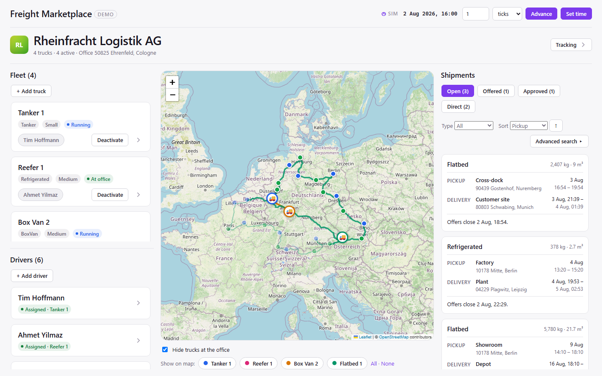
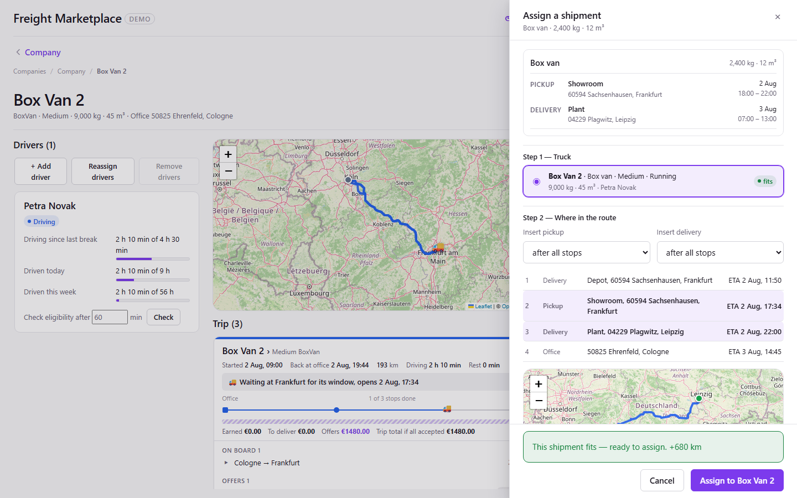
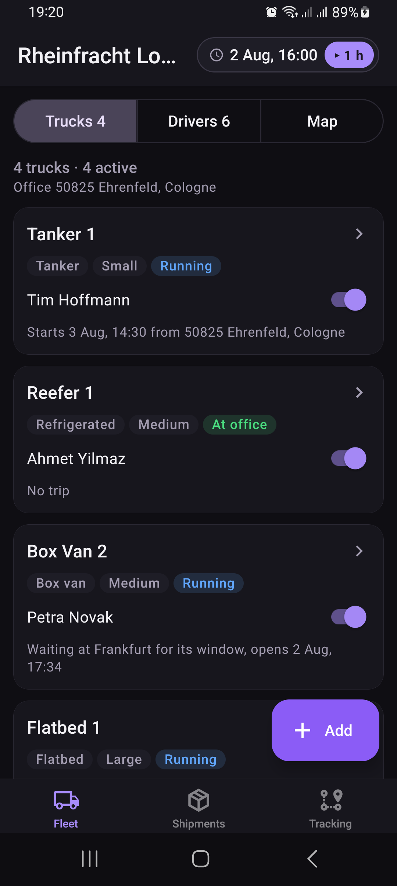
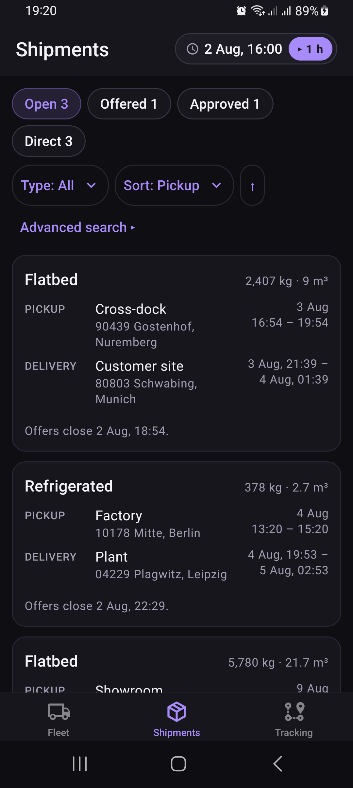

# Freight Marketplace

A freight platform for European road transport. Shippers book cargo, and trucking companies plan it onto their trucks. Every arrival time is checked against EU driving and rest-hour law.

## What it is

Shippers post shipments with a pickup and delivery location, a load and time windows. Every trucking company is notified, checks the shipment against its own fleet and sends priced offers; the shipper accepts one, and the winning company adds the shipment to the offered truck's route. A shipper can also book a shipment directly to one company. Trucking companies manage their trucks and drivers in the same apps. A simulation clock then moves the trucks along real roads, so routes, stops and driver hours change over time.

The hard part is the feasibility check. Before a shipment is added to a truck, the system works out whether the truck can really get there in time. It uses real road times from OSRM and the EU 561 rules for driver breaks and rest: the daily and weekly limits, split breaks, reduced rest, extended driving days and two-driver teams. It also checks the truck's capacity and every stop already on its route. [freight-overview.md](freight-overview.md) explains the problem and why getting the arrival time right matters.

This is a portfolio project. It shows a domain-driven .NET backend and a TypeScript frontend (web and Android) applied to a domain with real regulatory rules.

<!--
## Screenshots

| Fleet management (web) | Assigning a shipment (web) |
|---|---|
|  |  |

| Fleet tab (Android) | Shipments tab (Android) |
|---|---|
|  |  |
-->

## Features

**For shippers (web)**
- Book a shipment with map pickers: open to every trucking company, or directly to one.
- Compare waiting offers and accept one; change the times to get new offers.

**For trucking companies (web and Android)**
- Manage trucks and drivers, with fleet, trip and shipment maps on OpenStreetMap.
- Get a push notification for each new shipment and see which of your trucks could take it, where it would fit in their routes and how many km it adds.
- Send priced offers (one per truck, optional time limit), then add an accepted offer to the trip.
- Assign shipments booked directly to you, with a live feasibility check.
- The Android app follows Android conventions; each phone belongs to one company.

**Engine (backend)**
- Feasibility and arrival times that follow the EU 561 driving and rest rules, checked against capacity and every stop already on the route.
- A simulation clock (5-minute ticks) that moves trucks along real roads, reaches stops and advances each driver's hours.

## Tech stack

| Area | Technology |
|---|---|
| Backend | .NET 10, ASP.NET Core, EF Core, PostgreSQL 16 |
| Routing | OSRM (road distance, time and geometry) |
| Push notifications | Firebase Cloud Messaging (Firebase Admin SDK) |
| Web apps | React 19.2, TypeScript, Vite, Leaflet |
| Android app | Expo SDK 57, React Native 0.86, Expo Router, React Native Paper, MapLibre |
| Tests | xUnit, Vitest, Jest with React Native Testing Library, Playwright |
| CI | GitHub Actions |

## Architecture

A layered, domain-driven .NET backend (Domain, Application, Infrastructure, Api) and an npm workspace of three apps, where the web and Android fleet apps share one logic package. Diagrams, a request traced end to end, and the cross-cutting decisions are in [freight-architecture.md](freight-architecture.md); the reasons behind each decision are in [docs/adr/](docs/adr/).

## Repository layout

```
backend/
  src/        Freight.Domain, Freight.Application, Freight.Infrastructure, Freight.Api
  tests/      unit, API, infrastructure and multi-day integration tests
  tools/      Freight.Seeder (demo data)
frontend/
  api-client/            shared API client
  shipment/              shipper web app
  fleetmanagement/
    core/                shared fleet-management logic
    web/                 fleet-management web app (with Playwright e2e tests)
    mobile/              fleet-management Android app
docs/
  adr/                   architecture decision records
  design/                design notes
freight-*.md             product and domain documentation
```

## Run it locally

### Prerequisites
- .NET 10 SDK and the EF Core tool: `dotnet tool install --global dotnet-ef`
- Node.js 24
- Docker (for PostgreSQL)
- For the Android app only: Android Studio with an emulator, and JDK 17 (see the [mobile README](frontend/fleetmanagement/mobile/README.md))

### 1. Database
```bash
cd backend
docker compose up -d
dotnet ef database update --project src/Freight.Infrastructure --startup-project src/Freight.Api
dotnet run --project tools/Freight.Seeder
```
The seeder replaces all data with the demo set: 5 trucking companies, 20 shippers, 23 shipments and the clock at 1 Aug 2026 05:00 UTC. It creates no trucks or drivers.

### 2. API
Create `backend/src/Freight.Api/appsettings.Development.json`. It is gitignored. Only the CORS origins are needed for the web apps:

```json
{
  "Cors": { "AllowedOrigins": ["http://localhost:5173", "http://localhost:5174"] }
}
```

Two optional settings turn on push notifications:
- `Fcm:ServiceAccountPath`: the path to a Firebase service-account key. Without it, notifications are only logged.
- `DeviceTokenEncryption:Key`: a base64 AES key used to encrypt device IDs. Without it, devices can't register for push, and everything else works.

```bash
dotnet run --project src/Freight.Api
```
The API listens on http://localhost:5017.

### 3. Web apps
In each app folder, create a `.env` file with `VITE_API_BASE_URL=http://localhost:5017`, then:

```bash
npm install                                   # once, at the repository root
npm run dev -w fleetmanagement-web            # fleet management: http://localhost:5173
npm run dev -w shipment                       # shipper app:      http://localhost:5174
```

### 4. Android app
See [frontend/fleetmanagement/mobile/README.md](frontend/fleetmanagement/mobile/README.md). The app needs its own native build; it doesn't run in Expo Go.

## Tests

| Suite | Command |
|---|---|
| Backend (all projects; needs Docker running) | `dotnet test backend/Freight.slnx` |
| Shared fleet logic | `npm test -w @freight/fleetmanagement-core` |
| Android component tests | `npm test -w fleetmanagement-mobile` |
| Fleet web end-to-end (Playwright) | `npm run test:e2e -w fleetmanagement-web` |

The end-to-end tests need the API running, and **they reseed the database** before and after the run.

GitHub Actions runs three workflows:
- **Backend CI:** builds and tests the backend against PostgreSQL.
- **Frontend CI:** typechecks and tests the core, web and Android packages.
- **E2E CI:** starts the API and runs the Playwright suite.

## Documentation

| Document | Contents |
|---|---|
| [freight-overview.md](freight-overview.md) | The problem, the two tracks, and who uses what |
| [freight-ui-screens.md](freight-ui-screens.md) | App tour: every screen of the three apps |
| [freight-architecture.md](freight-architecture.md) | The moving parts, a request end to end, and the cross-cutting decisions |
| [freight-domain-model.md](freight-domain-model.md) | The domain model in diagrams: aggregates, lifecycles and key flows |
| [freight-driving-rules.md](freight-driving-rules.md) | The EU 561 driving and rest rules the simulation follows |
| [freight-frd.md](freight-frd.md) | Functional requirements, scope decisions and accepted limitations |
| [freight-build-plan.md](freight-build-plan.md) | The vertical slices the project was built in |
| [docs/adr/](docs/adr/) | Architecture decision records |

## Synthetic data

All shipments, companies, trucks, drivers and routes are synthetic demo data. Locations are real, publicly documented places (cities and named districts), used only so maps look realistic. None of the business data represents real people, companies or transactions. The fleet-management web app marks itself as a demo in its header.

## License

[MIT](LICENSE) © 2026 Ritesh Totlani.
