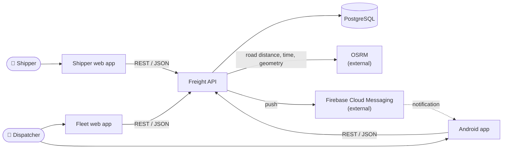
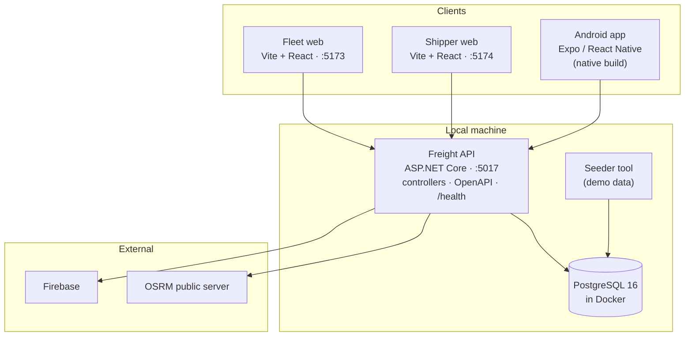
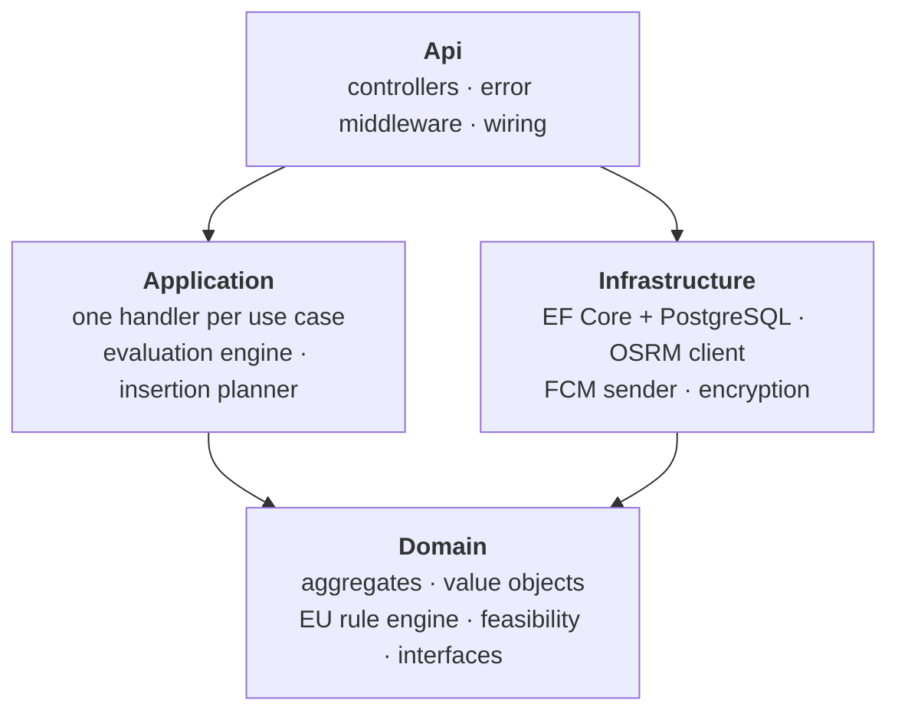
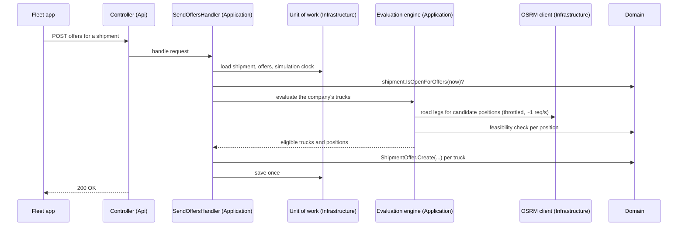
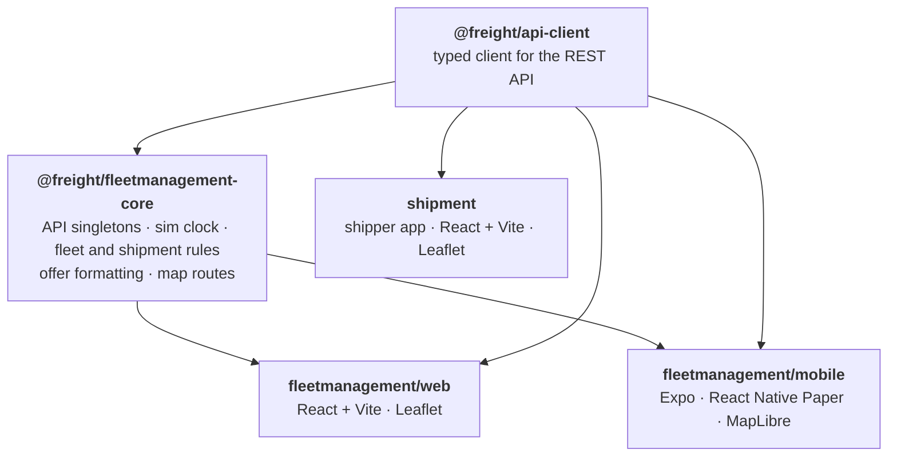
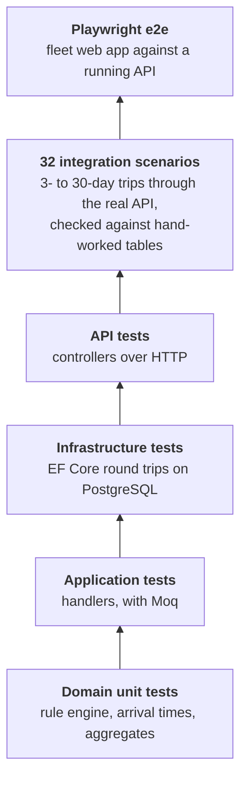

# Freight Marketplace — Architecture

The moving parts, how a request flows through them, and the decisions that shape them.
The domain itself is in [freight-domain-model.md](freight-domain-model.md); the reasons behind each decision are in [docs/adr/](docs/adr/).

---

## 1. System context

---

## 2. What runs where

The database schema is managed with EF Core migrations. The seeder replaces all data with a synthetic demo set.

---

## 3. Backend layers

| Layer | Holds | Depends on |
|---|---|---|
| **Domain** | Aggregates, value objects, the EU rule engine, feasibility and arrival-time calculation, and the interfaces it needs (repositories, routing, notifications) | **Nothing** — no framework, no EF Core |
| **Application** | One handler per use case, registered automatically (every class named `…Handler`); the per-company evaluation engine | Domain |
| **Infrastructure** | The implementations of the Domain interfaces: EF Core repositories and unit of work, OSRM client, FCM sender, device-ID encryption | Domain |
| **Api** | Controllers, error middleware, dependency wiring and configuration | All three |

**Rules:** a handler loads aggregates through repositories, calls domain methods, and saves **once** through the unit of work. Controllers only translate HTTP to a handler call.

---

## 4. One request, end to end

"Send offers" touches every layer:

---

## 5. Errors

One middleware in the Api maps exceptions to responses; controllers don't catch anything.

| What happened | Response |
|---|---|
| A domain or application rule was broken (`ArgumentException`, `InvalidOperationException`) | **400** with the rule's message |
| OSRM was unreachable or found no route (`RoutingUnavailableException`) | **503**, worth retrying |

---

## 6. Frontend packages

- An **npm workspace**: one install, one lock file.
- The two fleet apps share **all their logic** through `fleetmanagement-core`; only the screens differ.
- **One React version (19.2.3)** across the whole repository, because Expo requires it exactly.
- All maps use OpenStreetMap tiles, so no map API key is needed.

---

## 7. Cross-cutting decisions

| Topic | How it works | ADR |
|---|---|---|
| **Time** | One `SimulationClock`, stored in the database, is "now" for every rule. Business code never reads the wall clock. It advances in 5-minute ticks, on request. | 0008 |
| **Routing** | OSRM is the only source of road distance and time. Calls are **throttled to one every 1.1 s** to respect the public server, and road geometry is **cached in memory**. | 0006 |
| **Push** | FCM behind an `INotificationSender` interface. Without a Firebase key the API only logs; without an encryption key, phones can't register. Either way the API runs. | 0003 |
| **Who gets notified** | Every company on booking, with no matching at booking time; each company checks its own fleet on demand. | 0007 |
| **Secrets** | Only in the gitignored `appsettings.Development.json` (database, CORS, Firebase, encryption key). CI runs without any. | — |
| **Not present, on purpose** | Authentication, background jobs, message queues. Everything happens on a request. | — |

---

## 8. Testing and CI

Frontend: **Vitest** for the shared core, **Jest** with React Native Testing Library for the Android app.

| Workflow | Runs |
|---|---|
| **Backend CI** | Builds the solution and runs all five backend test projects against a PostgreSQL service |
| **Frontend CI** | Type-checks and tests the core, web and Android packages |
| **E2E CI** | Migrates a database, starts the API and runs the Playwright suite |

---

## 9. Decisions

| ADR | Decision |
|---|---|
| [0001](docs/adr/0001-stack-selection.md) | C# / ASP.NET Core backend, React web and React Native mobile clients |
| [0002](docs/adr/0002-client-facet-split.md) | Shipper on web only; fleet management on web and mobile |
| [0003](docs/adr/0003-fcm-push-behind-notification-abstraction.md) | Real FCM push behind a notification interface |
| [0004](docs/adr/0004-suburb-level-geography-with-osrm-map-routing.md) | Suburb-level demo geography, OSRM for map routes |
| [0005](docs/adr/0005-loading-time-and-working-time-directive-deferred.md) | Loading takes no time; the Working Time Directive is out of scope |
| [0006](docs/adr/0006-osrm-only-no-pricing-no-haversine.md) | OSRM as the only distance and time source |
| [0007](docs/adr/0007-shipment-evaluation-insertion-search.md) | Notify companies on booking; evaluate feasibility on demand, per company |
| [0008](docs/adr/0008-simulation-only-time-on-one-clock.md) | Simulation-only time on a single clock |
| [0009](docs/adr/0009-trip-aggregate-owns-the-stops.md) | A Trip aggregate owns the stops: inserted anywhere, never deleted |
| [0010](docs/adr/0010-offers-and-direct-shipments.md) | Offers and direct shipments: the shipper accepts one quote |
| [0011](docs/adr/0011-maps-on-openstreetmap-without-keys.md) | Maps on OpenStreetMap, without API keys |
| [0012](docs/adr/0012-integration-tests-against-hand-worked-results.md) | Integration tests against hand-worked expected results |
