# Freight Marketplace — Domain Model

How the domain works, mostly in diagrams: the shared model (§1), **Track A — Truck Simulation** (§2–§6) and **Track B — Bidding / Marketplace** (§7–§12). The code in `backend/src/Freight.Domain` is the field-by-field reference; [§13](#13-where-to-find-it-in-the-code) points to it.

---

## 1. The model at a glance

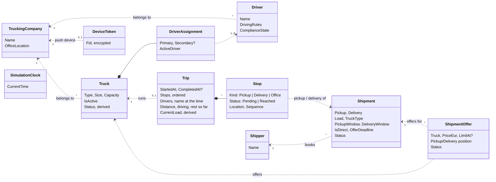

**How to read it:** a filled diamond (◆) means *owns* — saved and changed together. A dotted arrow means *refers to by id*. Only two things are owned: a Truck's driver assignment, and a Trip's stops (with its record of drivers).

**The parts of the domain:**

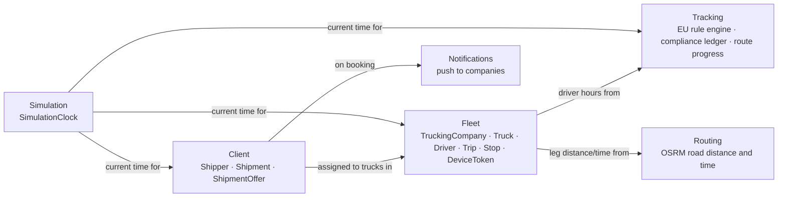

---

# Track A — Truck Simulation

## 2. A truck's route: Trip and Stops

A truck has at most one **open Trip**. The Trip owns the ordered stops. Stops are **never deleted**, only marked `Reached`, so a Trip is the permanent record of the journey.

A real route interleaves shipments. Here a Large truck (24 t) carries A and B, and shipment **C is being inserted** in the middle of the route while the truck is already driving:

```mermaid
flowchart LR
    S(["Start<br/>office"]) -->|0 t| PA["Pickup A · 8 t<br/>✓ Reached"]
    PA -->|8 t| PB["Pickup B · 6 t<br/>✓ Reached"]
    PB -->|14 t| DB["Delivery B<br/>✓ Reached"]
    DB -->|"8 t · 🚚 truck is here"| PC["Pickup C · 10 t<br/>NEW"]
    PC -->|18 t| DA["Delivery A<br/>Pending"]
    DA -->|10 t| DC["Delivery C<br/>NEW"]
    DC -->|0 t| O(["Office<br/>always last"])
    classDef reached fill:#2e7d32,stroke:#1b5e20,color:#ffffff
    classDef added fill:#1565c0,stroke:#0d47a1,color:#ffffff
    class PA,PB,DB reached
    class PC,DC added
```

*Numbers on the arrows: the load on board for that leg.*

- **Shipments interleave:** B is picked up and delivered while A is still on board.
- **Inserted anywhere, not only appended:** C's pickup and delivery go between existing stops, ahead of A's delivery. Sequence numbers leave gaps (10, 20, 30…), so an insert never renumbers the whole route.
- **Every later stop is re-checked:** inserting C adds driving time, so Delivery A must still make its window, with the driver's breaks and rests included (§6).
- **Capacity is checked on every leg:** the peak is 18 t of 24 t, so C fits. It is checked again at the real moment of pickup.
- **Stops are never deleted:** reached stops stay on the Trip. The **office** stop is added with the first shipment and always stays last.

**The Trip is also the record of the journey**, for the Tracking page and its history:

- **Drivers:** every driver who drove on it, with their name at that time — the truck's drivers when the Trip opens, and any driver assigned while it runs. Each is recorded once.
- **Distance and driving so far:** the planned km and driving ticks of every leg covered (a leg cut short by an insert counts the part already driven). While a leg is under way, the truck's progress on it is added on top when shown, so nothing is counted twice.
- **Rest so far:** one tick for every tick the driver rules stopped the truck — breaks, daily and weekly rests together. Waiting for a stop's window is not rest; it is kept on the stop.
- **A new Trip starts clean:** when a truck opens its next Trip, the progress left over from its last leg home is dropped, so none of the old Trip's distance or driving is carried into the new one.

---

## 3. One clock for everything

There is no real time in the system. A single **SimulationClock** holds "now", and every booking, offer and deadline uses it. Advancing the clock moves the whole fleet at once, in **5-minute ticks**:

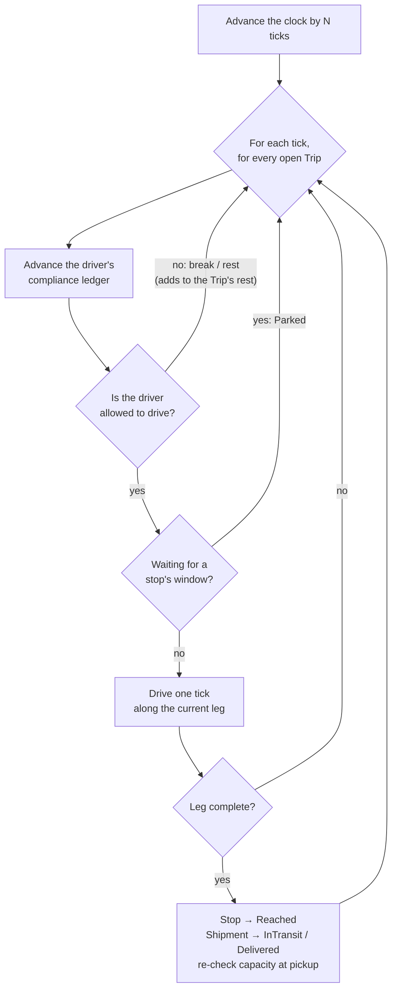

---

## 4. Where is the truck? Derived from driving time

There is no GPS. The only fact the system knows is **how long the driver has driven on the current leg**. Distance and position are derived from that:

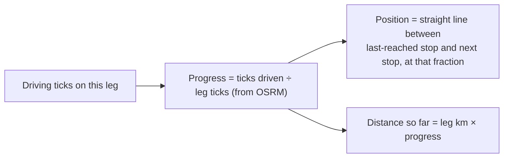

No open trip means the truck is at its company's office. The maps still draw the real road route; only the *position dot* uses the straight line.

---

## 5. Drivers: company, compliance ledger and team swap

**Company.** Every driver is added to a trucking company, as every truck is. A truck only takes drivers of its own company, and a truck or driver without a company can't be given drivers or a truck. Either can leave its company and later join any company:

- **No direct move:** joining a company while still in another is refused; leave first.
- **Not during a trip:** leaving is refused while the truck, or the driver's truck, has an open trip.
- **A truck that leaves** loses its drivers and is switched off.
- **A driver that leaves** comes off its truck. From a team the other driver stays on as the single driver, and the truck stays on; a truck left with no driver is switched off.

Each driver has fixed **driving rules**, chosen once (full or split break, full / reduced / split daily rest, full or reduced weekly rest, extended driving days). The **compliance ledger** tracks their continuous, daily, weekly and two-week driving under the EU 561 rules. It starts fully rested when the truck's trip starts. Details are in [freight-driving-rules.md](freight-driving-rules.md).

A **Large** truck can have two drivers. The active driver only ever moves forward:

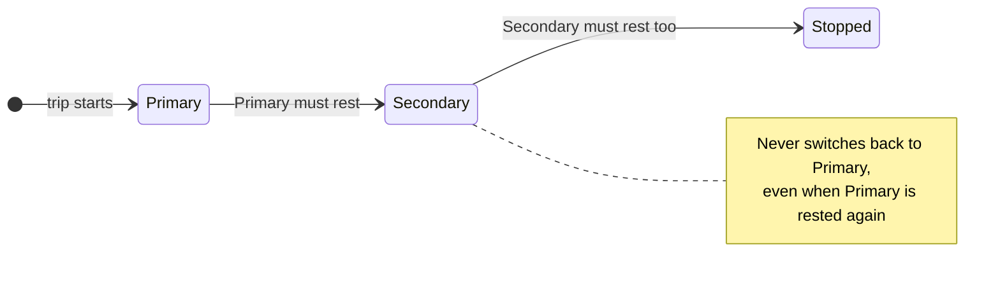

---

## 6. Can this truck take the shipment? (feasibility)

Every assignment is first tried on a **copy** of the trip, so a "no" never changes anything:

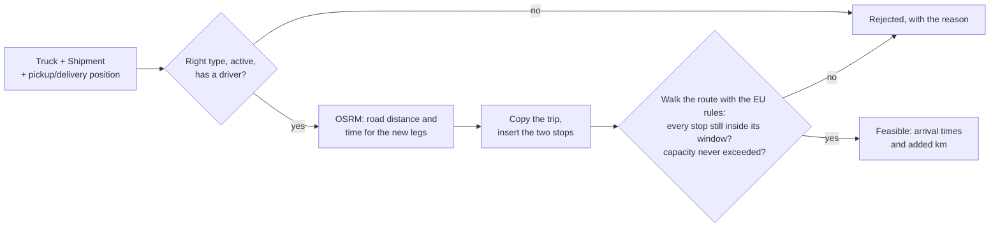

The dispatcher can run this as a dry run first, and it runs again when they press Assign. The dry
run also answers with the route as it would look: every remaining stop in order with its place
name and forecast arrival (none when the capacity check already said no), the two new stops
marked, and the km the shipment adds.

---

# Track B — Bidding / Marketplace

## 7. Two ways to book, and who gets a push

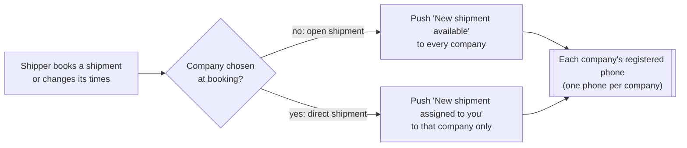

- **Open:** every company may bid for it during the 2-hour offer window.
- **Direct:** only the chosen company sees it. No offers, no time limit; it assigns a truck itself.
- A failed push never fails the booking. Without Firebase keys the API only logs the push.

---

## 8. Check eligibility: which of our trucks could take it?

A dispatcher asks this for **their own** fleet, on demand. Nothing is calculated at booking time.

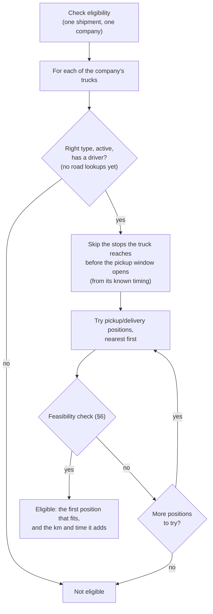

---

## 9. The offer window

Every open shipment has **one 2-hour window** (simulation time), starting at booking. Offers can be sent and accepted only inside it. An example:

```mermaid
gantt
    title One open shipment, booked at 08:00
    dateFormat HH:mm
    axisFormat %H:%M
    section Shipment
    Offer window, 2 h              :active, w1, 08:00, 2h
    Dead, hidden from companies    :crit, d1, 10:00, 1h
    New window after Change times  :active, w2, 11:00, 2h
    section Company 1
    Offer for truck X, limit 09:30 :o1, 08:20, 09:30
    section Company 2
    Offer for truck Y, no limit    :o2, 08:40, 10:00
```

- **One offer per truck**, with a price in **EUR** and an optional **limit**. A company sends all its offers for a shipment **in one go**; the server re-checks the trucks and stores each truck's positions on the offer.
- An offer is **waiting** until its limit or the window's end, whichever comes first.
- **Nothing accepted by 10:00:** the shipment is *dead* — companies no longer see it, and the shipper is asked to change the times.
- **Change times** (11:00 here) starts a new 2-hour window, rejects all waiting offers and pushes again. Companies can then send new offers.

**An offer's life.** Only three statuses are stored. "Waiting" is **calculated** when read; nothing ever sweeps old offers.

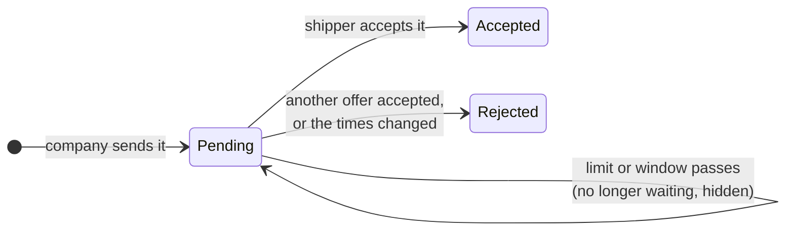

---

## 10. A company's four lists

Each company sees every pending shipment in **at most one** list:

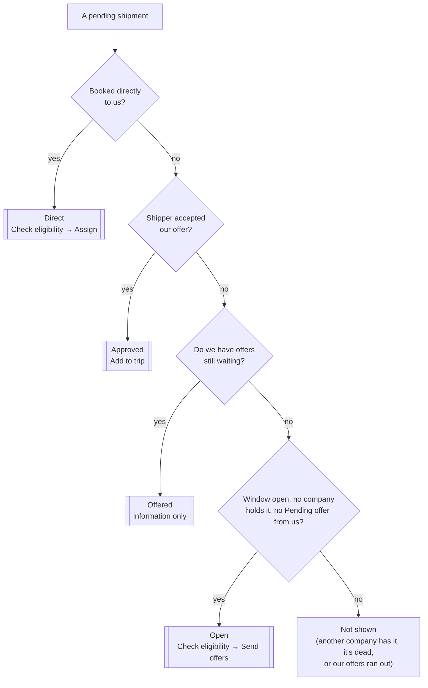

---

## 11. A shipment's life

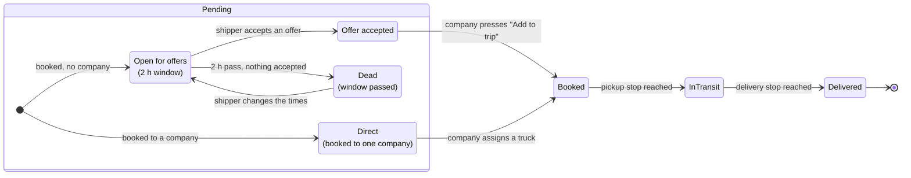

`Booked` means the stops are on a truck's trip (Track A takes over from there).

---

## 12. The two flows end to end

**Open shipment: offers → accept → Add to trip**

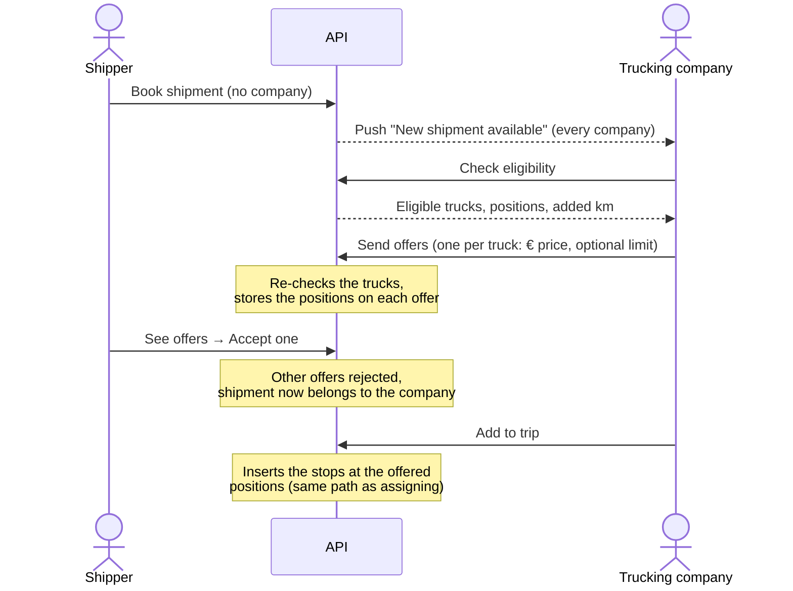

**Direct shipment: booked to one company**

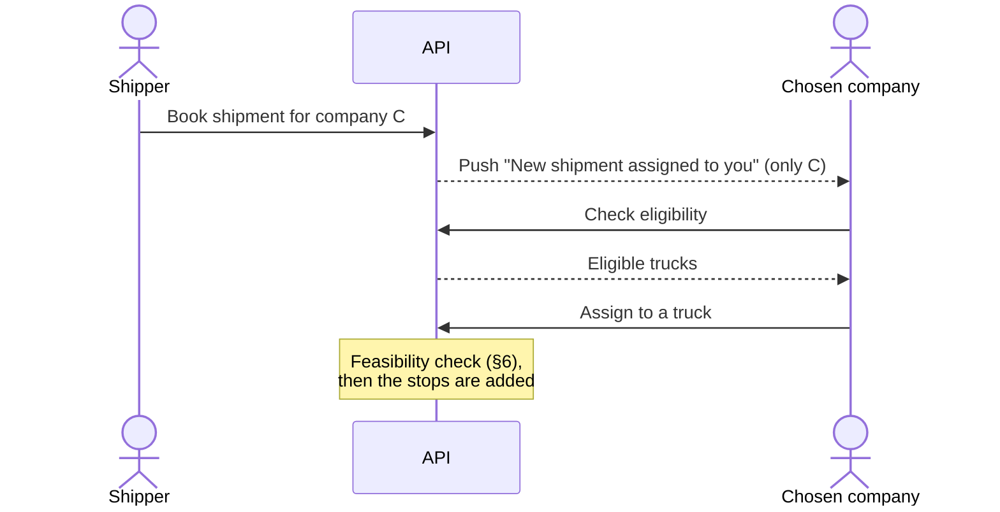

**Known limits:** accepting checks nothing; Add to trip re-checks only the offered positions (if the route changed so they no longer fit, it returns the assignment's error rather than finding another position); and two accepts at the same moment aren't guarded against.

---

## 13. Where to find it in the code

| Concept | Code (`backend/src`) |
|---|---|
| Shipment, ShipmentOffer, Shipper | `Freight.Domain/Client/` |
| TruckingCompany, Truck, Driver, Trip, Stop, DeviceToken | `Freight.Domain/Fleet/` |
| Feasibility check (§6) and arrival times | `Freight.Domain/Fleet/Services/ShipmentInsertionEvaluator.cs`, `RouteEtaCalculator.cs` |
| EU rule engine, compliance ledger, route progress | `Freight.Domain/Tracking/` |
| Simulation clock | `Freight.Domain/Simulation/SimulationClock.cs` |
| Clock advance loop (§3) | `Freight.Application/Simulation/` |
| Check eligibility (§8) | `Freight.Application/Evaluation/`, `Freight.Application/Fleet/ShipmentInsertionPlanner.cs` |
| Offers: send, accept, Add to trip, company lists | `Freight.Application/Offers/` |
| Assign a shipment to a truck | `Freight.Application/Fleet/` |
| OSRM client, FCM push, EF Core persistence | `Freight.Infrastructure/` |

---

## 14. Design rules

- **Aggregates refer to each other by id**, never by holding the other object. Only a Truck's driver assignment and a Trip's stops and drivers are owned.
- **One use case = one handler = one save.** Repositories only track changes; the handler commits once.
- **The Domain project has no framework dependencies** — no EF Core, no ASP.NET.
- **Derived, not stored:** truck status, truck position, current load, arrival times, and whether an offer is still waiting.
- **No background jobs.** Everything happens on a request, including advancing the clock.
