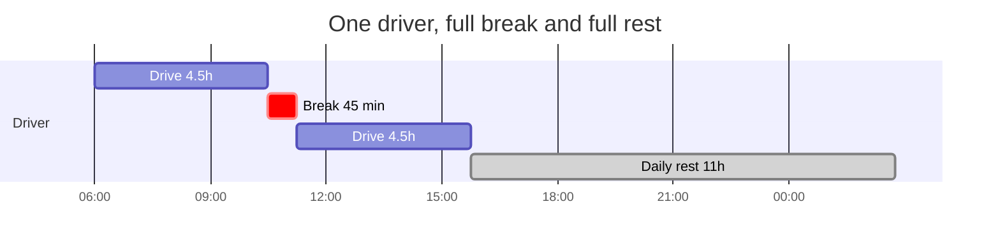
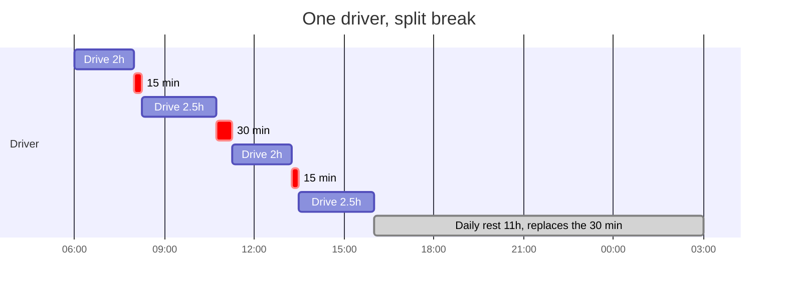
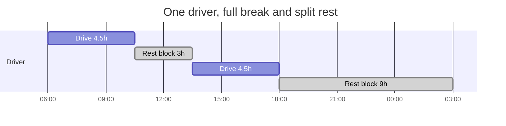
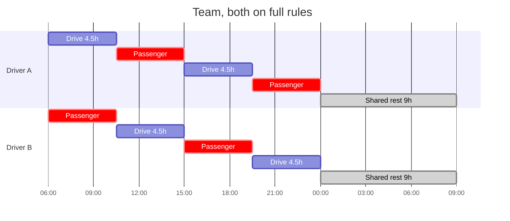
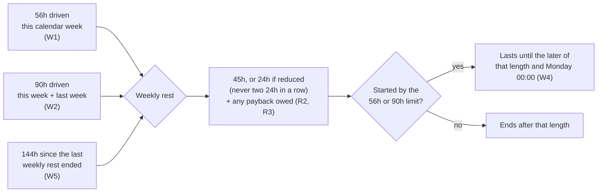
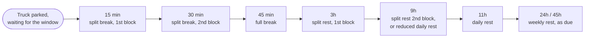

# Freight Marketplace — Driver Driving and Rest Rules

The EU 561/2006 driving and rest rules as this project models them: what a driver may do,
when they must stop, and how long for.

- Every rule detail that EU 561 leaves open was decided with the product owner; the
  decisions and the options rejected are in [section 9](#9-decisions). A rule tagged
  "(Decision N)" comes from decision N there.
- If this document and the code disagree, the code has a bug - or the rule changed and
  this document must be updated first. Rules are never changed to make a test pass.
- Update this document whenever a rule changes.

## 1. How the rules run

| Topic | Rule |
|---|---|
| Time | Simulated only. The `SimulationClock` advances in 5-minute ticks (`POST /simulation/advance`); nothing uses real time. |
| Where the rules live | `DriverRuleEngine` (`backend/src/Freight.Domain/Tracking/Services/`). It updates each driver's ledger (`Driver.ComplianceState`, a `DriverComplianceState`). |
| Numbers | `RestRuleLimits.Default` (`backend/src/Freight.Domain/Tracking/ValueObjects/RestRuleLimits.cs`). Change a limit there, not in the engine. |
| Forecast = actual | ETAs and "can this truck take this shipment" replay the **same engine** on a copy of the ledger (`RouteEtaCalculator`). There is no second implementation of the rules. A stop must be reached exactly when it was forecast. |
| Boundaries are exact | A limit that falls inside a tick is respected to the minute; the rest of the tick goes to the stop that follows. The result never depends on how the clock advances are cut up. |
| Calendar week | Monday 00:00 to Sunday 24:00, **UTC**. |
| Trip start | A new trip starts with a **fully rested driver and nothing pending** (the ledger is reset in `Driver.ResetComplianceForNewTrip`): no driving this week or last week, the last daily and weekly rest both "ended" at the trip start, no weekly rest owed, no reduced rests or extended days used, no break block pending. Every new ledger field must be reset there too. |
| Trip end | The trip closes when the truck reaches the office, and the driver's ledger is frozen there. If a limit is reached in that same moment, the rest it requires has started: the ledger shows the rest, not "Driving, 0 left". (Decision 11) |

## 2. Each driver's options

A driver has four settings (`DrivingRules`, chosen when the driver is created):

| Setting | Values |
|---|---|
| Break | `FullBreak` (45 min) or `SplitBreak` (15 min + 30 min) |
| Daily rest | `FullRest` (11h), `ReducedRest` (9h) or `SplitRest` (3h + 9h) |
| Weekly rest | `FullWeeklyRest` (45h) or `ReducedWeeklyRest` (24h, alternating) |
| Extension | `ExtendDailyDrivingWhenEligible`: 10h days when allowed |

## 3. Limits at a glance

| Limit | Value |
|---|---|
| Driving before a break | 4.5h |
| Break | 45 min, or 15 min (after 2h) + 30 min (at 4.5h) |
| Daily driving | 9h; 10h on an extended day (at most 2 per calendar week) |
| Daily rest | 11h; 9h reduced (at most 3 between weekly rests); or 3h + 9h split |
| Daily rest deadline | must **end** within 24h of the previous rest ending |
| Weekly driving | 56h per calendar week |
| Two-week driving | 90h in this week + last week |
| Weekly rest | 45h; 24h reduced (never twice in a row) |
| Weekly rest deadline | must **start** within 144h (six days) of the previous weekly rest ending |
| Team daily rest | 9h together, starting within 21h of the previous one ending |

### What a day looks like

**One driver, full rules** — the simplest day: two 4.5h stints, one break, an 11h rest.

**One driver, split break** — 15 min at 2h, 30 min at 4.5h. At the end of the day the daily limit is reached while the 30-min block is due, so the daily rest replaces it (B3).

**One driver, split rest** — at the first 4.5h a 3h block instead of the break; at the daily limit a 9h block completes the rest (D5).

**Two drivers on a Large truck** — they swap every 4.5h and the truck keeps moving for 18h; riding as passenger counts as a break. When neither can drive, both rest 9h together (M1–M4): a 27h cycle.

## 4. Single driver

### 4.1 Breaks

| # | Rule |
|---|---|
| B1 | **Full break:** after 4.5h of driving since the last break, a 45-min break. It resets the 4.5h count. |
| B2 | **Split break:** after 2h since the last full break, a 15-min block (the 4.5h count keeps running). When the count reaches 4.5h, a 30-min block; that resets the count. |
| B3 | **A rest replaces a break.** If the daily limit is reached when a break (or a pending 30-min block) is due, the daily rest starts instead and covers it; the next day starts with no block pending. EU 561 Art. 7: a break is required "unless he takes a rest period". (Decision 8) |

### 4.2 Daily driving and extension

| # | Rule |
|---|---|
| D1 | At most 9h of driving between two daily rests; then a daily rest. |
| D2 | **Extension:** a driver with the extension setting drives 10h instead of 9h, decided at the moment the day reaches 9h, if fewer than 2 extended days have been used this calendar week. The count restarts at Monday 00:00. |

### 4.3 Daily rest

| # | Rule |
|---|---|
| D3 | **Full rest:** 11h. It resets the day's driving and the 4.5h count. |
| D4 | **Reduced rest:** 9h, at most 3 times between two weekly rests; the fourth is forced to 11h. |
| D5 | **Split rest:** at the first 4.5h mark of the day a **3h block** instead of the break (it counts as the break; the day's driving is not reset). At the daily limit a **9h block** completes the rest. If no 3h block was taken by the daily limit, a normal 11h rest. |
| D6 | **Split break + split rest:** 15-min block at 2h as usual; at 4.5h the 3h block replaces the pending 30-min block. (Decision 9) |
| D7 | The daily rest resets nothing weekly. |
| D8 | **24h deadline:** the daily rest must end within 24h of the previous daily or weekly rest ending (the trip start counts). So it must start by **13h** (11h rest) or **15h** (9h rest, or the 9h block of a split rest) after that, even if the driver has driven less than 9h. Time since the last rest is wall-clock time: driving, breaks and waits all count. |

### 4.4 Weekly and two-week limits

| # | Rule |
|---|---|
| W1 | At most **56h** of driving in a calendar week. Reaching it starts the weekly rest. |
| W2 | At most **90h** in this calendar week plus last week. Reaching it starts the weekly rest. |
| W3 | At Monday 00:00 this week's driving becomes last week's, and this week starts at 0. A tick crossing midnight is split. A weekly rest does **not** reset these counters. |
| W4 | **Rest until Monday:** a driver who reached 56h or 90h may not drive again before Monday 00:00, so that weekly rest lasts until the **later** of its normal length and Monday 00:00. The whole time counts as rest. (Decisions 3, 4) |
| W5 | **Six-day rule:** a weekly rest must start no later than 144h after the previous weekly rest ended (or the trip start), whatever the driving total. |
| W6 | If the 144h mark arrives during a daily rest, that rest becomes the weekly rest and the time already rested counts. (Decision 1) |

**What starts a weekly rest, and how long it lasts:**

### 4.5 Weekly rest

| # | Rule |
|---|---|
| R1 | **Full weekly rest:** always 45h. |
| R2 | **Reduced weekly rest:** 24h, but never twice in a row: 24h, 45h, 24h, ... The first weekly rest of a trip may be reduced. |
| R3 | **Payback:** a weekly rest shorter than 45h owes the difference (21h for a 24h rest). The debt is added to the **next** weekly rest: 45h + 21h = 66h. A weekly rest of 45h or more (for example one that lasts until Monday) owes nothing. (Decision 2) |
| R4 | A weekly rest resets the day, the break count and the reduced-daily-rest count, and restarts the 144h clock. |

## 5. Waiting at a stop

When the truck reaches a stop before its window opens, it parks until the window opens.
Loading time is not modelled (ADR 0005), so the driver is free for the whole wait.

A longer wait earns more: the wait is credited once, as the largest step its length reaches **that applies to this driver** (a split-rest block only for a split-rest driver, and so on). A wait too short for any step that applies counts as nothing (T2). The table gives the exact conditions:

| # | Rule |
|---|---|
| T1 | **Every wait counts as a break or rest by its length**, credited once as a whole: |
| | 15 min or more - the split break's first block (split-break driver, first block not taken) |
| | 30 min or more - the split break's second block (first block already taken) (Decision 7) |
| | 45 min or more - a full break |
| | 3h - the split rest's first block (split-rest driver, no 3h block yet today) |
| | 9h - the split rest's second block (3h block already taken), or the daily rest of a reduced-rest driver |
| | 11h or more - the daily rest |
| | 24h or 45h (as due, including any payback) - the weekly rest |
| T2 | A wait shorter than every threshold counts as nothing; the 4.5h count keeps running. |
| T3 | A wait that starts during a break or rest continues it. The minutes left after that block ends are **never driving**; they are a new wait counted by their own length. (Decision 5) |
| T4 | A wait still running when the 24h daily-rest deadline arrives: the daily rest counts **from the start of the wait**, and the truck leaves when the rest is complete. (Decision 6) |
| T5 | A planned departure later than now: the truck waits at the office and the driver's day starts at departure. |

## 6. Team driving (two drivers, Large truck only)

| # | Rule |
|---|---|
| M1 | The primary driver starts. At 4.5h the co-driver takes the wheel if they can drive; the truck keeps moving. If not, the truck stops for a normal break. |
| M2 | Time riding as passenger (`DriverActivity.Passenger`) counts as break only: 45 min as passenger completes the break. It never counts as daily or weekly rest. |
| M3 | A driver who reaches the daily limit rides as passenger; nobody rests while the truck moves. |
| M4 | When neither can drive, the truck stops and both take a **9h** daily rest together, whatever their own daily-rest setting. |
| M5 | The shared rest must start within **21h** of the previous one ending (the trip start counts), even if a driver could still drive. |
| M6 | When **either** driver reaches a weekly or two-week limit, the truck stops and both take their weekly rest (each by their own weekly setting); the truck moves when both have finished. The six-day rule and rest-until-Monday apply the same way (the rest lasts until Monday for the driver who reached the limit). |
| M7 | Waits are credited to both drivers. |
| M8 | After a shared rest, the primary driver takes the wheel. |
| M9 | The 10h extension applies per driver. Split break and split rest do **not** apply to team drivers: they take their breaks as passenger. |

With two drivers on full rules this gives a 27h cycle: A 4.5h, B 4.5h, A 4.5h, B 4.5h
(18h without stopping), then a 9h shared rest.

## 7. Known simplifications

- Calendar weeks are in UTC.
- A trip always starts with a fully rested driver (section 1); trips are not chained.
- Only driving, breaks and rests are modelled - no "other work" or availability time.
- A wait is always free time (no loading or unloading).
- Team drivers ignore split break and split rest.
- The payback is always taken at the next weekly rest (EU 561 also allows attaching it to
  another rest within three weeks).

## 8. Where it is tested

| Level | Where |
|---|---|
| Rule engine | `backend/tests/Freight.Domain.Tests/Tracking/Services/DriverRuleEngineTests.cs` |
| Forecast | `backend/tests/Freight.Domain.Tests/Fleet/Services/RouteEtaCalculatorTests.cs` |
| Whole trips through the API | `backend/tests/Freight.Integration.Tests` - 32 scenarios of 3 days to 30 days, each checked against a hand-worked table in `Results/`. Coverage: `SCENARIOS.md`. |

## 9. Decisions

Details EU 561 leaves open, decided one at a time with the product owner on 2026-09-27.
Changing one of these means changing the rule it shaped, its tests, and the hand-worked
integration results that depend on it.

| # | Question | Decision | Rejected | Rule |
|---|---|---|---|---|
| 1 | The six-day (144h) mark arrives while the driver is already on a daily rest | The daily rest turns into the weekly rest, and the time already rested counts (9.75h into the rest: 35.25h of 45h left). | Finish the daily rest, then a separate 45h rest; stop at 144h and start a fresh 45h rest. | W6 |
| 2 | When is the 21h owed from a reduced (24h) weekly rest paid back? | Added to the next weekly rest: 45h + 21h = 66h. | Added to the next daily rest; no payback (alternation only). | R3 |
| 3 | The 56h weekly cap is reached mid-week and the weekly rest would end before Monday | The weekly rest lasts until the later of its normal length and Monday 00:00; the whole time counts as rest (a reduced rest that runs to 35.5h owes 9.5h). | The rest ends at its normal length, then a separate "waiting for Monday" state. | W4 |
| 4 | The 90h two-week limit is reached mid-week | Same as decision 3 (e.g. a 60.5h rest, a regular one, nothing owed). | A separate "waiting for Monday" state. | W4 |
| 5 | A wait outlasts a break or rest that is already running | The leftover after the block ends is a new wait counted by its own length (45 min or more a break, 11h or more a daily rest, ...); never driving. | The leftover is parked time with no credit. | T3 |
| 6 | A wait is still running when the 24h daily-rest deadline arrives | The daily rest counts from the start of the wait; the truck leaves when the rest is complete (deadline 13h, wait 10h - 16h: rest 10h - 21h). | The rest counts from the deadline; the time waited before it is a break. | T4 |
| 7 | Split break: a wait of 30 - 44 min after the 15-min first block | It is the 30-min second block; the 4.5h count resets. (15 min or more before the first block is the first block; 45 min or more is the whole break.) | Only 45 min or more counts. | T1 |
| 8 | Split break: the 9h daily cap is reached while the 30-min second block is pending (every normal day: 4.5h + 4.5h) | The daily rest starts at once and replaces the pending block; the next day starts with no block pending. EU 561 Art. 7: a break is required "unless he takes a rest period". | 30-min block, then the 11h rest; rest now with the block still owed next day. | B3 |
| 9 | A driver with both split break and split rest: the first 4.5h of the day | The 15-min block at 2h as usual; at 4.5h the 3h block replaces the pending 30-min block. | 30-min block, then the 3h block; no 15-min block at 2h (legal and 15 min faster, but the two rules stop being independent). | D6 |
| 10 | What does the driver owe when a trip starts? | Nothing: a fully rested driver, no rest pending (section 1, "Trip start"). | - | Section 1 |
| 11 | The office is reached in the same tick the driver reaches a driving limit | The trip closes and the driver's rest starts there; the ledger is frozen showing the rest. | Freeze the ledger as "Driving, 0 left in day". | Section 1 |
