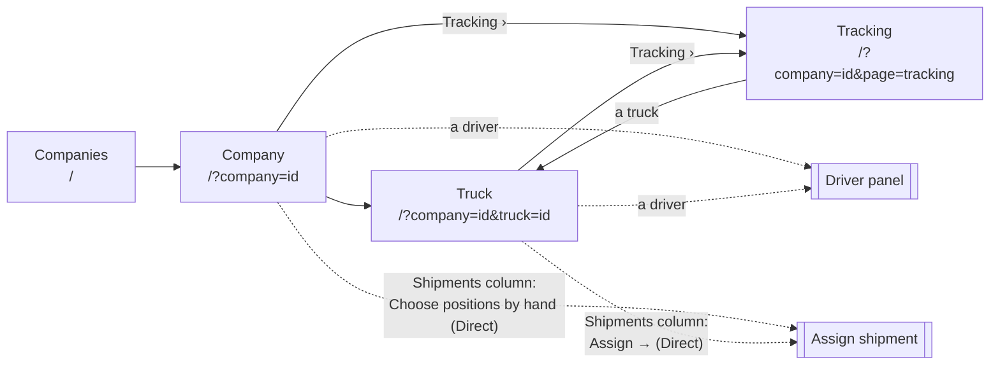
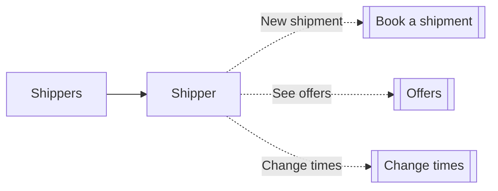

# Freight Marketplace — App Tour

The three apps, screen by screen: what each screen shows and what you can do there.
How the domain behind them works is in [freight-domain-model.md](freight-domain-model.md).

| App | Who uses it | Where |
|---|---|---|
| Fleet management (web) | Trucking company dispatcher | `frontend/fleetmanagement/web` |
| Fleet management (Android) | Trucking company dispatcher, one company per phone | `frontend/fleetmanagement/mobile` |
| Shipper (web) | Shipper | `frontend/shipment` |

<!-- Screenshots: every "📷" line below marks where an image goes. The shot list and the
     capture instructions are in §5 "Screenshot plan"; remove §5 once all images are in. -->

---

## 1. Fleet management — web

A sim-clock bar is on every screen: advance by ticks or hours, or set a time. Every screen
refreshes when the clock moves, so trucks visibly drive. Its progress ("Advancing the clock…"),
the result ("Now …", closing after about 3 seconds) and errors show in a message at the top.

**Popups** come in two kinds with one look, in both web apps. Small forms — Add a truck, Add
a driver, Drivers of a truck, Change trip start, Set simulation time, the shipper's Change
times — open as a **centred box**. Bigger work — Assign a shipment, the driver panel, Trucks
ready to start, the shipper's Offers — opens as a **side panel** from the right, the page still
visible beside it. The page behind is dimmed. Each has its title with a line saying what it is
about, a body that scrolls, and its buttons in a footer that always stays visible, the main one
named after what it does ("Assign to Flatbed 1", "Save new times"). Esc, a click outside or ×
closes it, and popups sit above the maps. A time is chosen as a date field and a time field.

The address names the page: `/` is the Companies list, `/?company=<id>` a company,
`/?company=<id>&truck=<id>` one of its trucks and `/?company=<id>&page=tracking` its Tracking
page (`&trackTruck=<id>` when opened from a truck). A refresh stays on the page, and the
browser's Back and Forward move between pages. The truck and Tracking pages have a breadcrumb
(Companies / company / truck or Tracking); the company page has none. To switch company, open `/`.

### Companies
📷 `docs/images/web-companies.png`

- Every trucking company with its logo, truck count and office city.
- Pick one to open it. Companies are set up by an administrator, not in the app.

### Company
📷 `docs/images/web-fleet.png`

The page fills the window. Under the company's logo and name ("N trucks · N active"), with **Tracking ›** on the right, are three columns, each scrolling on its own:

- **Left, Fleet:** each truck's type, size and status, its drivers, and an Activate/Deactivate toggle. A truck without a driver can't be activated. **+ Add truck**: name, type and size, each type and size with what it means ("Box van · closed, dry goods", "Large · 24,000 kg · 90 m³"), nothing chosen in advance; capacity follows from the size. **+ Assign driver** offers only this company's drivers not yet on a truck. Hovering a truck highlights it on the map and its drivers below.
- **Left, Drivers** (below Fleet): every driver of the company, assigned trucks first in fleet order, then the unassigned ones A–Z. **+ Add driver** (first and last name and the driver's fixed rule choices, each option in words, e.g. "Full · 45 min after 4 h 30 of driving", nothing chosen in advance) adds the driver to this company. After either Add, a centred **✓ Truck added — FL-14 · Flatbed · Large** / **✓ Driver added — Lena Brandt** closes by itself after about 3 seconds (Esc or a click closes it sooner), and the new row is highlighted for a moment. A driver opens the driver panel.
- **Middle, Fleet map:** every active truck's route on real roads in its own colour, its live position and the office. Click a truck to open it. Under the map: **Hide trucks at the office** (ticked by default) and a chip per active truck, with **All · None**, to choose which trucks the map shows. A shipment selected in the Shipments column is drawn on top, pickup → delivery in a dark line, with the trucks faded; the note over the map names it and **✕ back to fleet** clears it.
- **Right, Shipments:** the company's four shipment lists (below).

### Truck
📷 `docs/images/web-truck.png`

The page fills the window, laid out like the company page. Under the truck's name ("Flatbed · Large · 24,000 kg · 90 m³ · Office …"), with **Tracking ›** (Tracking for this truck), its status and the Activate/Deactivate switch, are three columns, each scrolling on its own:

- **Left, Drivers:** **+ Add driver** adds a driver to the company; the confirmation says to put them on the truck with Assign ("✓ Driver added — Lena Brandt · put them on this truck with Assign"). **+ Assign driver** / **Reassign drivers** offers only this company's drivers: one, or two on a Large truck. **Remove drivers** while no trip is open. A card per driver shows what they are doing now (Driving, Co-driver (riding), On a break, …) and their driving since the last break, today and this week against the EU 561 limits, with a bar that turns red at the limit, and **Check eligibility after N min** "can they still drive then?". A driver's name opens the driver panel.
- **Middle, the trip:** the map of the whole route on real roads, reached stops greyed out, and the live position; with no trip, the office. Below it, **Trip**: the truck's trip as a card, the same as on the Tracking page (below), and **Change trip start** until the truck has moved. With no trip: "No trip — the truck is at the office."
- **Right, Shipments (type):** the company's shipment lists (below) for this truck only — shipments of its type, in the tabs **Direct, Open, Offered, Approved**, with no type filter. **Direct:** **Assign →** opens the assign screen with this truck already chosen. **Open:** only this truck is checked; if it can take the shipment, a price, an optional limit and **Send offer**, otherwise why not. A one-line note says a shipment leaves Open once any truck of the company has offered on it, until the shipper changes its times. **Offered:** this truck's waiting offers. **Approved:** offers accepted for this truck, with **Add to trip**.

### Tracking
📷 `docs/images/web-tracking.png`

The company's trips seen from the shipments' side: what its trucks carry, where each shipment
is, what is still offered for them, what a trip earns, and what was done before. Under
"Tracking" and the company's name ("N trips running") are two tabs.

**Trips running now** (default) shows every trip not yet back at the office, all at once, 2–3
cards to a row:

- Above the cards: **Truck** and **Shipper** filters, **Sort** (next stop soonest, earnings,
  truck name), **Show map / Hide map** and **Ready to start (N)**.
- A summary strip over the trips shown: trips running; shipments on them (delivered, on
  board, to pick); earned (delivered); to deliver (on board + to pick); offers (accepted +
  waiting).
- The map (hidden until **Show map**): every trip shown, in its truck's colour, as on the
  company page. Clicking a truck selects its card.
- **Ready to start** opens a side panel with the idle trucks that have an offer the shipper
  accepted; **Add to trip** puts the shipment on the truck, which starts its trip.

**A trip card** — the heading: the truck (opens the truck page), its type and its drivers
("(team)" with two); started, back at the office (forecast), km, driving and rest so far;
a **Now** line ("Driving Reims → Metz, 64 km left · driver Jonas Weber", "Waiting at … for
its window, opens …", "Daily rest on the way to …, until …", "Starts … from …"); the stops as
a line of dots with the truck on it ("N of M stops done"); and the money: earned, to deliver,
offers and the trip total if all offers are accepted, as a bar. Clicking the heading
collapses the card to it (and selects the trip on the map).

Under the heading, the trip's shipments one line each, grouped **Delivered**, **On board**,
**To pick** and **Offers** (groups with nothing in them are left out): the towns, the
delivered time or the forecast arrival at the next stop, ✓ or "late …", and the price ("–"
for a direct booking, which has no price). An accepted offer has **Add to trip** on its line;
a waiting offer shows until when the shipper can answer; declined and expired offers are not
shown. A line opens to the shipment as the shipper app shows it: a status pill and the load,
pickup and delivery with place name, area and window, the shipper, picked-up and delivered
times or the forecast, on time or late, and the price.

**History** shows the trips that completed in a period: **This week, Last week, Month,
Year, From – to** (sim time; a trip belongs to the period it completed in; weeks start on
Monday) and a **Truck** filter. A summary: completed trips, shipments delivered, tonnes
carried, earned, on time % and distance. Then a card per trip, newest first, laid out like a
running trip's card: the truck, who drove it, start – end, km, driving, rest, what it earned
and how many shipments were late, and its shipments one line each, opening to the shipper
app's card. A trip that completed before drivers were recorded shows "–" for its drivers.

The page refreshes when the clock moves.

### Shipments (company page, right column)
📷 `docs/images/web-shipments-offers.png`

The company's shipments in four tabs with counts, each shipment in at most one. The truck page shows the same lists for one truck (above).

One line above the lists, kept when switching tabs:

- **Type** — the shipment's required truck type, or All.
- **Sort** — Pickup (default), Delivery, Load, Type, or Offers close (Open and Offered only), with **↑/↓** for the direction.
- **Advanced search** (closed at first) — a pickup and a delivery date/time range. A shipment shows if its window overlaps the range. With dates set the button reads **Advanced search (N)** and **Clear** clears the dates.

The tab counts are the filtered numbers. When the filters hide everything: "No shipments match these filters."

Each shipment is a card, as in the shipper app: type and load; pickup and delivery, each with place name, area and window; then a line for the tab — when offers close (Open), our offers with truck, positions, price and limit (Offered), the accepted offer (Approved), or "Booked directly" (Direct). Clicking a card selects it, shows it on the fleet map and opens its actions:

- **Open** — the company's trucks of the shipment's type that can take it, least extra driving first, each with the km and time it adds ("from the office and back" for a truck at the office). Tick trucks, enter a price (€) and an optional time limit, and **Send offers** in one go.
- **Offered** — information only.
- **Approved** — **Add to trip** puts it on the offered truck.
- **Direct** — the same truck list, each truck with where its stops would go ("New trip, starts now" or the positions in its route) and **Assign**. **Choose positions by hand →** opens the assign screen with this shipment.

Below the trucks that can take it, the other trucks of that type are listed with why not: inactive, no driver assigned, too small for the load, or doesn't fit its route, time windows or driving rules. With no truck of that type at all: "No <type> truck in this fleet."

### Assign shipment
📷 `docs/images/web-assign-shipment.png`

A side panel. Under the title, the shipment's type, weight and volume.

- Opened from a Direct shipment: the shipment is shown on top, and only trucks of its type that are big enough, active and have a driver are offered. From the truck page, that truck is already chosen and the only one offered. Without a shipment, pick a truck, then one of the direct shipments that fit its type and capacity.
- Each truck is a card: name, type, size and status, its capacity and its drivers; the chosen one shows whether the shipment fits.
- Choose where the pickup and delivery go in the route ("before stop 2 (Pickup · Bonn)"), and the trip start, as a date and a time, for a new trip.
- **The route as it would look:** every remaining stop in order with its place and its forecast arrival (ETA), the two new stops highlighted; then the map.
- **Feasibility is re-checked live** as you change the truck, the positions or the start. The result stays in sight above the footer: "This shipment fits — ready to assign. +410 km", or the reason it doesn't fit. **Assign to {truck}** assigns it.

### Driver panel
📷 `docs/images/web-driver.png`

A side panel over the company or truck page, from a driver's name. Read-only, and refreshed as the clock moves. Under the name: the company and what the driver is doing now (Driving, On a break, …).

- The driver's truck (a link to it from the company page), or "Not assigned to any truck"; on a two-driver truck, **Team with** the other driver, which opens their panel.
- **Full tracking** once the truck has opened a trip: **Now** (current activity and how long it has lasted), **Breaks**, **Today** and **Week**, each measured against the EU 561 limits, with a bar that turns red at the limit. Lines that don't apply to the driver's rules are left out.
- The driver's fixed rule choices, each with what it means ("Daily rest: Reduced · 9 h, at most 3 times between weekly rests").

---

## 2. Shipper — web

### Book a shipment
📷 `docs/images/shipper-new-shipment.png`

- Pickup and delivery chosen on a map, load, truck type, and pickup and delivery windows.
- **Assign to company** (optional): leave it empty to let every company bid, or pick one company to book it directly.

### Shipper's shipments
📷 `docs/images/shipper-shipments.png`

Each pending shipment shows where it stands:

- **Offers close …** with **See offers (n)** and **Change times**;
- **No offer accepted — change times** once the 2-hour window has passed;
- **Offer accepted — … is adding it to a trip**;
- **Booked directly to …**.

### Offers
📷 `docs/images/shipper-offers.png`

A side panel. Under the title: the route, the truck type and when offers close, with the time left.

- Each waiting offer is a card: company (the cheapest marked **Lowest** when there are several), price, how long it is valid and when it was sent. **Accept** asks once more on the card ("The other offers will be rejected."); accepting one rejects the others.
- **Change times** (a centred box) sets new windows — for each stop a From and a To, each a date and a time — starts a new offer window and notifies the companies again.

---

## 3. Fleet management — Android

Built to Android conventions: bottom tabs, the sim clock as a chip in the top bar,
floating action buttons, bottom sheets for short choices, full-screen forms, pull to refresh.

### Choose company
📷 `docs/images/android-choose-company.png`

- Shown once, on first launch. The phone then belongs to that company, and every screen shows only it.

### Fleet tab
📷 `docs/images/android-fleet.png`

- A map preview of every running truck's route (each in its own colour) and the truck cards with an activation switch.
- **Add** (floating button): add a truck or a driver; the driver joins this company. A truck's **Assign drivers** offers only this company's drivers.

### Full-screen map
📷 `docs/images/android-fleet-map.png`

- Pan and zoom; tap a stop for its name, tap a truck to open it.

### Truck
📷 `docs/images/android-truck.png`

- The same as the web truck screen: trip map, stops, drivers, compliance, change trip start.
- **Assign shipment** (floating button) opens the full-screen assign form, for direct shipments.

### Shipments tab
📷 `docs/images/android-shipments.png`

- The same four lists as on web, as segmented buttons with counts. Expanding a card shows its route map.

### Send offers
📷 `docs/images/android-send-offers.png`

- **Check eligibility** opens a sheet with the eligible trucks and the km each adds. Tick trucks, enter prices, optionally pick a limit, and **Send offers**.

### Notification
📷 `docs/images/android-notification.png`

- A new open shipment pushes "New shipment available" to every company; a direct one pushes "New shipment assigned to you" to its company only.
- Tapping it (or **View** on the in-app banner) opens that shipment's details.

---

## 4. Shared by the fleet apps

- **One logic package** (`@freight/fleetmanagement-core`) for web and Android: the API clients, the sim clock, the fleet and shipment rules and the map routes. Only the screens differ.
- **Maps on OpenStreetMap:** Leaflet on web, MapLibre on Android, no map API key. Routes follow real roads (OSRM). No map ever draws the whole fleet and all shipments at once; each screen shows only what it needs.
- **One sim clock:** advancing it on any screen refreshes every screen.

---

## 5. Screenshot plan

*Working section: delete it once every 📷 above has its image.*

### 5.1 Before capturing: demo data

The seeded database has companies, shippers and shipments, but no trucks, drivers or trips.
Add the data below **through the API** (it adds, it wipes nothing; a reseed removes it again).
Use one seeded company as "our" company and a second one as the competitor.

| # | Data | Needed for |
|---|---|---|
| 1 | Our company: 4 trucks (one of each type; one **Large**), 5 drivers, all trucks active | Company, Fleet tab |
| 2 | Large truck with **two drivers** (team) | Truck, Driver |
| 3 | Two trucks with a **running trip**: 2–3 shipments each, interleaved (A picked up, B picked up and delivered, then A delivered), clock advanced so some stops are reached | Fleet map, Truck, Android map |
| 4 | Open shipments: one with **no offer yet** (for Open), one with **our waiting offers** (2 trucks) | Shipments, Send offers |
| 5 | One open shipment with offers from **both companies** | Shipper offers |
| 6 | One shipment where the shipper **accepted our offer** | Approved, shipper card |
| 7 | One **direct** shipment booked to our company | Direct, Assign shipment |
| 8 | One open shipment whose **2-hour window has passed** | Shipper "change times" card |

Keep the sim clock at one fixed time for all screenshots so dates match across images.

### 5.2 How to capture

- **Web:** browser window **1440 × 900**, light theme, zoom 100 %. Playwright (already in `frontend/fleetmanagement/web`) can capture at a fixed size.
- **Android:** the emulator (Pixel, portrait), captured with `adb exec-out screencap -p > docs/images/<name>.png`.
- Save as PNG in `docs/images/` with the exact names below. Crop browser chrome; keep each image under about 500 KB.
- Use only the synthetic demo data (no real names or companies).

### 5.3 Shot list

| # | File | App | Where | Must be visible |
|---|---|---|---|---|
| 1 | `web-companies.png` | Fleet web | Companies | Several companies with logos and truck counts |
| 2 | `web-fleet.png` ★ | Fleet web | Company | All three columns: fleet and drivers, map with **two routes** and live positions, shipments |
| 3 | `web-truck.png` | Fleet web | Truck (running, team) | All three columns: both drivers with their driving bars; route map with reached (grey) and pending stops; the trip card with its Now line, stop dots and shipment lines; the Shipments tabs |
| 4 | `web-shipments-offers.png` | Fleet web | Company → Shipments column → Open | A selected card with its route on the fleet map, **two trucks ticked with prices**, Send 2 offers button; tab counts |
| 5 | `web-assign-shipment.png` ★ | Fleet web | Truck → Shipments → Direct → Assign → | The truck already chosen, route preview with the new stops and **"This shipment fits — ready to assign."** |
| 6 | `web-driver.png` | Fleet web | Driver panel (driver of the running truck) | Full tracking with bars, and rule choices |
| 7 | `web-tracking.png` | Fleet web | Company → Tracking (several trips running) | Summary strip, **two or three trip cards** with Now lines, stop dots, earnings bars and shipment lines in several states, one line opened to its shipper card; an accepted offer with Add to trip |
| 8 | `shipper-new-shipment.png` | Shipper web | Shipper → New shipment | Both pins on the map, filled form, company dropdown |
| 9 | `shipper-shipments.png` | Shipper web | Shipper | Cards in several states: offers open, accepted, direct, change times |
| 10 | `shipper-offers.png` | Shipper web | See offers | **Two offers** from different companies with Accept |
| 11 | `android-choose-company.png` | Android | First launch | Company list (clear app data first) |
| 12 | `android-fleet.png` ★ | Android | Fleet tab | Map preview with routes, truck cards, Add button |
| 13 | `android-fleet-map.png` | Android | Fleet map, full screen | Two coloured routes, trucks, office |
| 14 | `android-truck.png` | Android | Truck (running) | Trip map and stops |
| 15 | `android-shipments.png` ★ | Android | Shipments tab | Segmented buttons with counts, one card expanded with its route map |
| 16 | `android-send-offers.png` | Android | Open → Check eligibility | Sheet with trucks ticked and prices entered |
| 17 | `android-notification.png` | Android | Book a shipment while the app is open | The in-app banner "New shipment available" with View |

★ = also shown in the README. When the images are in, un-comment the README's Screenshots section.
