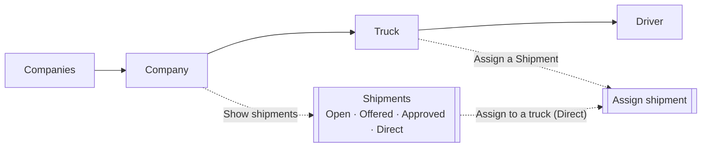
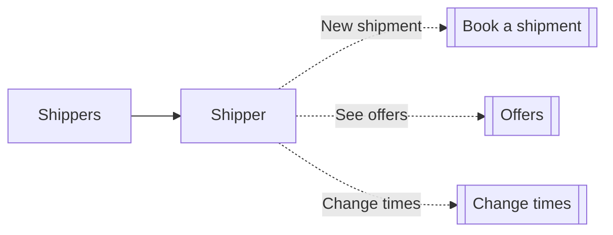
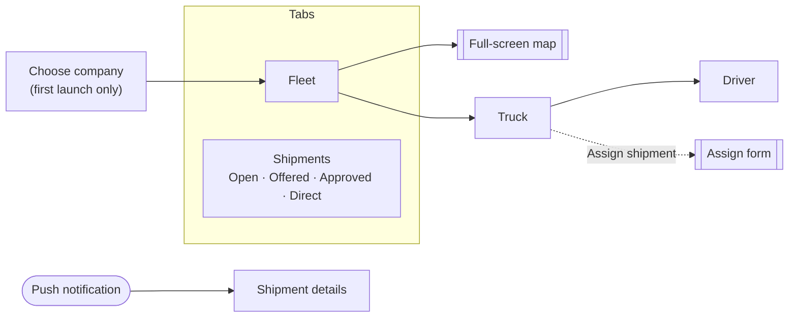

# Freight Marketplace — App Tour

The three apps, screen by screen: what each screen shows and what you can do there.
How the domain behind them works is in [freight-domain-model.md](freight-domain-model.md).

| App | Who uses it | Where |
|---|---|---|
| Fleet management (web) | Trucking company dispatcher | `frontend/fleetmanagement/web` |
| Fleet management (Android) | Trucking company dispatcher, one company per phone | `frontend/fleetmanagement/mobile` |
| Shipper (web) | Shipper | `frontend/shipment` |

<!-- Screenshots: every "📷" line below marks where an image goes. The shot list and the
     capture instructions are in §5 "Screenshot plan"; remove §5 once all images are in. -->

---

## 1. Fleet management — web

A sim-clock bar is on every screen: advance by ticks or hours, or set a time. Every screen
refreshes when the clock moves, so trucks visibly drive. A breadcrumb shows where you are.

### Companies
📷 `docs/images/web-companies.png`

- Every trucking company with its logo, truck count and office city.
- Pick one to open it. Companies are set up by an administrator, not in the app.

### Company
📷 `docs/images/web-fleet.png`

- **Fleet map:** every truck's route on real roads, its live position and the office. Click a truck to open it.
- **Fleet:** each truck's type, size and status, with an Activate/Deactivate toggle. A truck without a driver can't be activated.
- **Drivers:** who drives which truck, plus the drivers not assigned yet.
- **Add truck** (capacity follows from the size) and **Add driver** (with the driver's fixed rest-rule choices).

### Truck
📷 `docs/images/web-truck.png`

- **Route map** of this truck's trip, with reached stops greyed out and the live position.
- **Stops** in route order: reached time or "Pending", and each leg's distance and driving time.
- **Drivers:** assign one, or two on a Large truck; remove them while no trip is open.
- The primary driver's **compliance** (continuous, daily and weekly driving) and **Check eligibility** "can they still drive after N minutes?".
- **Change trip start**, until the truck has moved. **Assign a Shipment** opens the assign screen.

### Shipments
📷 `docs/images/web-shipments-offers.png`

The company's shipments in four tabs, each shipment in at most one:

- **Open** — **Check eligibility** lists the trucks that could take it and the km each adds. Tick trucks, enter a price (€) and an optional time limit, and **Send offers** in one go.
- **Offered** — our offers waiting for the shipper: truck, positions, price, limit.
- **Approved** — the shipper accepted our offer: **Add to trip** puts it on the offered truck.
- **Direct** — booked straight to us: **Check eligibility → Assign**, or **Assign to a truck →** to choose positions by hand.

### Assign shipment
📷 `docs/images/web-assign-shipment.png`

- Pick a truck, then one of the direct shipments that fit its type and capacity.
- Choose where the pickup and delivery go in the route, and the trip start for a new trip.
- The map shows the new route, and **feasibility is re-checked live** as you change the positions, with the reason when it doesn't fit.

### Driver
📷 `docs/images/web-driver.png`

- The driver's fixed rest-rule choices, assigned truck and compliance ledger. Read-only.

---

## 2. Shipper — web

### Book a shipment
📷 `docs/images/shipper-new-shipment.png`

- Pickup and delivery chosen on a map, load, truck type, and pickup and delivery windows.
- **Assign to company** (optional): leave it empty to let every company bid, or pick one company to book it directly.

### Shipper's shipments
📷 `docs/images/shipper-shipments.png`

Each pending shipment shows where it stands:

- **Offers close …** with **See offers (n)** and **Change times**;
- **No offer accepted — change times** once the 2-hour window has passed;
- **Offer accepted — … is adding it to a trip**;
- **Booked directly to …**.

### Offers
📷 `docs/images/shipper-offers.png`

- Each waiting offer: company, price and how long it is valid. **Accept** one, and the others are rejected.
- **Change times** (separate window) sets new windows, starts a new offer window and notifies the companies again.

---

## 3. Fleet management — Android

Built to Android conventions: bottom tabs, the sim clock as a chip in the top bar,
floating action buttons, bottom sheets for short choices, full-screen forms, pull to refresh.

### Choose company
📷 `docs/images/android-choose-company.png`

- Shown once, on first launch. The phone then belongs to that company, and every screen shows only it.

### Fleet tab
📷 `docs/images/android-fleet.png`

- A map preview of every running truck's route (each in its own colour) and the truck cards with an activation switch.
- **Add** (floating button): add a truck or a driver.

### Full-screen map
📷 `docs/images/android-fleet-map.png`

- Pan and zoom; tap a stop for its name, tap a truck to open it.

### Truck
📷 `docs/images/android-truck.png`

- The same as the web truck screen: trip map, stops, drivers, compliance, change trip start.
- **Assign shipment** (floating button) opens the full-screen assign form, for direct shipments.

### Shipments tab
📷 `docs/images/android-shipments.png`

- The same four lists as on web, as segmented buttons with counts. Expanding a card shows its route map.

### Send offers
📷 `docs/images/android-send-offers.png`

- **Check eligibility** opens a sheet with the eligible trucks and the km each adds. Tick trucks, enter prices, optionally pick a limit, and **Send offers**.

### Notification
📷 `docs/images/android-notification.png`

- A new open shipment pushes "New shipment available" to every company; a direct one pushes "New shipment assigned to you" to its company only.
- Tapping it (or **View** on the in-app banner) opens that shipment's details.

---

## 4. Shared by the fleet apps

- **One logic package** (`@freight/fleetmanagement-core`) for web and Android: the API clients, the sim clock, the fleet and shipment rules and the map routes. Only the screens differ.
- **Maps on OpenStreetMap:** Leaflet on web, MapLibre on Android, no map API key. Routes follow real roads (OSRM). No map ever draws the whole fleet and all shipments at once; each screen shows only what it needs.
- **One sim clock:** advancing it on any screen refreshes every screen.

---

## 5. Screenshot plan

*Working section: delete it once every 📷 above has its image.*

### 5.1 Before capturing: demo data

The seeded database has companies, shippers and shipments, but no trucks, drivers or trips.
Add the data below **through the API** (it adds, it wipes nothing; a reseed removes it again).
Use one seeded company as "our" company and a second one as the competitor.

| # | Data | Needed for |
|---|---|---|
| 1 | Our company: 4 trucks (one of each type; one **Large**), 5 drivers, all trucks active | Company, Fleet tab |
| 2 | Large truck with **two drivers** (team) | Truck, Driver |
| 3 | Two trucks with a **running trip**: 2–3 shipments each, interleaved (A picked up, B picked up and delivered, then A delivered), clock advanced so some stops are reached | Fleet map, Truck, Android map |
| 4 | Open shipments: one with **no offer yet** (for Open), one with **our waiting offers** (2 trucks) | Shipments, Send offers |
| 5 | One open shipment with offers from **both companies** | Shipper offers |
| 6 | One shipment where the shipper **accepted our offer** | Approved, shipper card |
| 7 | One **direct** shipment booked to our company | Direct, Assign shipment |
| 8 | One open shipment whose **2-hour window has passed** | Shipper "change times" card |

Keep the sim clock at one fixed time for all screenshots so dates match across images.

### 5.2 How to capture

- **Web:** browser window **1440 × 900**, light theme, zoom 100 %. Playwright (already in `frontend/fleetmanagement/web`) can capture at a fixed size.
- **Android:** the emulator (Pixel, portrait), captured with `adb exec-out screencap -p > docs/images/<name>.png`.
- Save as PNG in `docs/images/` with the exact names below. Crop browser chrome; keep each image under about 500 KB.
- Use only the synthetic demo data (no real names or companies).

### 5.3 Shot list

| # | File | App | Where | Must be visible |
|---|---|---|---|---|
| 1 | `web-companies.png` | Fleet web | Companies | Several companies with logos and truck counts |
| 2 | `web-fleet.png` ★ | Fleet web | Company | Fleet map with **two routes** and live positions; truck list; drivers |
| 3 | `web-truck.png` | Fleet web | Truck (running, team) | Route map with reached (grey) and pending stops; stops list; two drivers; compliance |
| 4 | `web-shipments-offers.png` | Fleet web | Show shipments → Open | Check eligibility open, **two trucks ticked with prices**, Send 2 offers button; tab counts |
| 5 | `web-assign-shipment.png` ★ | Fleet web | Truck → Assign a Shipment | Route preview with the new stops and **"Feasible"** |
| 6 | `web-driver.png` | Fleet web | Driver (of the running truck) | Rule choices and compliance ledger |
| 7 | `shipper-new-shipment.png` | Shipper web | Shipper → New shipment | Both pins on the map, filled form, company dropdown |
| 8 | `shipper-shipments.png` | Shipper web | Shipper | Cards in several states: offers open, accepted, direct, change times |
| 9 | `shipper-offers.png` | Shipper web | See offers | **Two offers** from different companies with Accept |
| 10 | `android-choose-company.png` | Android | First launch | Company list (clear app data first) |
| 11 | `android-fleet.png` ★ | Android | Fleet tab | Map preview with routes, truck cards, Add button |
| 12 | `android-fleet-map.png` | Android | Fleet map, full screen | Two coloured routes, trucks, office |
| 13 | `android-truck.png` | Android | Truck (running) | Trip map and stops |
| 14 | `android-shipments.png` ★ | Android | Shipments tab | Segmented buttons with counts, one card expanded with its route map |
| 15 | `android-send-offers.png` | Android | Open → Check eligibility | Sheet with trucks ticked and prices entered |
| 16 | `android-notification.png` | Android | Book a shipment while the app is open | The in-app banner "New shipment available" with View |

★ = also shown in the README. When the images are in, un-comment the README's Screenshots section.
